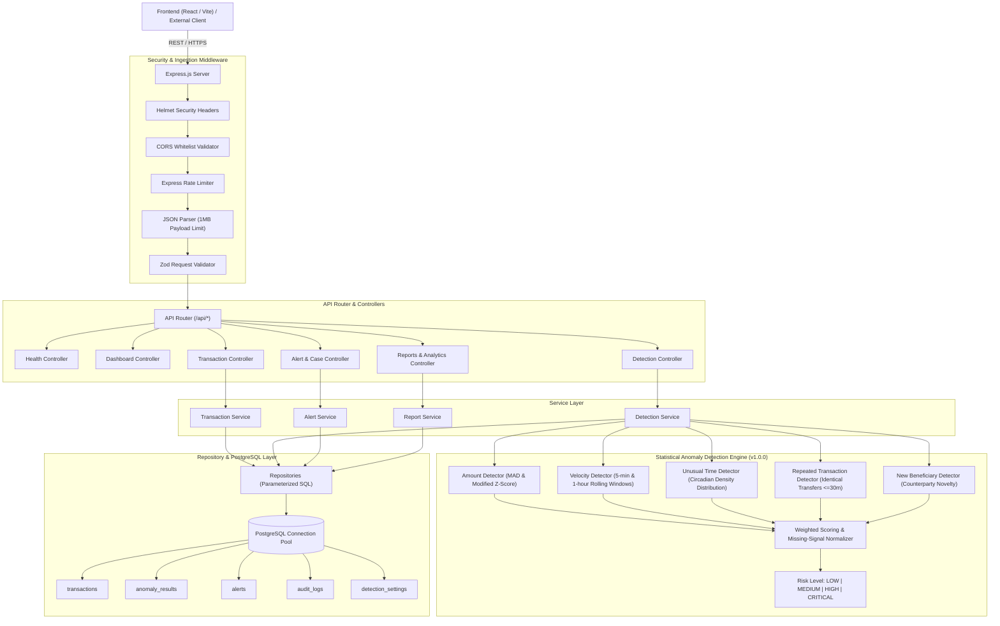
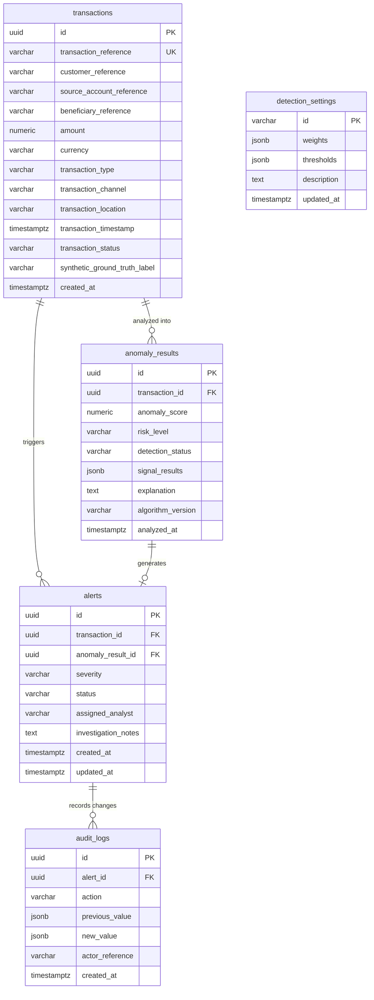

# Financial Transaction Anomaly Detection System (FTADS)

[](https://nodejs.org/)
[](LICENSE)
[]()
[]()

> **An academic, explainable, multi-signal statistical anomaly detection backend and RESTful API for identifying suspicious financial transactions.**

---

## Table of Contents
1. [Project Overview](#1-project-overview)
2. [Problem Statement](#2-problem-statement)
3. [Technology Stack](#3-technology-stack)
4. [System Architecture](#4-system-architecture)
5. [Database Schema](#5-database-schema)
6. [Detection Methodology & Mathematical Formulations](#6-detection-methodology--mathematical-formulations)
7. [Weighted Scoring & Normalization Formula](#7-weighted-scoring--normalization-formula)
8. [Synthetic Dataset Generation](#8-synthetic-dataset-generation)
9. [Installation & Getting Started](#9-installation--getting-started)
10. [Environment Variables](#10-environment-variables)
11. [Database Migration & Demo Reseeding](#11-database-migration--demo-reseeding)
12. [API Reference & Example Requests](#12-api-reference--example-requests)
13. [Security Architecture](#13-security-architecture)
14. [Automated Testing & Benchmark Results](#14-automated-testing--benchmark-results)
15. [Limitations & Academic Boundary](#15-limitations--academic-boundary)
16. [Frontend Integration Instructions](#16-frontend-integration-instructions)
17. [Git Workflow & PowerShell Commands](#17-git-workflow--powershell-commands)

---

## 1. Project Overview

The **Financial Transaction Anomaly Detection System (FTADS)** is a specialized backend engineering platform designed to process, analyze, and flag suspicious financial transactions in real-time and in batch. Built for academic research and regulatory transparency, FTADS rejects "black-box" machine learning in favor of an **explainable, deterministic statistical rules engine** that computes multi-factor risk scores and delivers verifiable natural language justifications for every alert.

---

## 2. Problem Statement

Modern banking fraud prevention faces two compounding challenges:
1. **Opaque Black-Box Models**: Deep learning models often lack auditability, making it difficult for compliance officers to explain why a transaction was frozen to financial regulators or customers.
2. **Extreme Outlier Sensitivity in Classical Statistics**: Standard statistical metrics like sample mean and standard deviation suffer from severe distortion in financial transaction datasets because extreme fraudulent transactions disproportionately skew both metrics.

**The FTADS Solution:**
FTADS implements non-parametric, robust statistical metrics—specifically the **Median Absolute Deviation (MAD)** and Boris Iglewicz & David Hoaglin **Modified Z-Scores**—combined with multi-window velocity checks, circadian temporal modeling, duplicate transaction heuristics, and counterparty novelty analysis.

---

## 3. Technology Stack

- **Runtime**: Node.js (LTS v20+ / v24+)
- **Server Framework**: Express.js (v4.21+) using JavaScript ES Modules (`type: module`)
- **Database**: PostgreSQL 17 / 18
- **PostgreSQL Client**: `pg` (Connection Pooling & Parameterized SQL)
- **Validation**: Zod (Runtime Schema Validation for params, queries, and request bodies)
- **Security**: Helmet (HTTP security headers), CORS (explicit domain whitelist), Express Rate Limit (DDoS defense)
- **Data Export**: `fast-csv` with automated CSV Formula Injection (`=`, `+`, `-`, `@`) sanitization
- **Unique Identifiers**: `uuid` (UUIDv4) and PostgreSQL `gen_random_uuid()`
- **Testing Engine**: Jest & Supertest (Unit & Integration tests with VM modules)

---

## 4. System Architecture



---

## 5. Database Schema



---

## 6. Detection Methodology & Mathematical Formulations

The FTADS detection engine coordinates five independent, explainable statistical detectors:

### A. Amount Anomaly Detector (Nominal Weight: 35%)
- Calculates the customer's historical **Median**:
  $$\tilde{x} = \text{median}(X)$$
- Calculates the **Median Absolute Deviation (MAD)**:
  $$\text{MAD} = \text{median}(|x_i - \tilde{x}|)$$
- Computes the Boris Iglewicz and David Hoaglin (1993) **Modified Z-Score**:
  $$M_i = \frac{0.6745 \cdot (x_i - \tilde{x})}{\text{MAD}}$$
  where $0.6745$ is the asymptotic consistency constant for normally distributed populations.
- **Zero MAD Handling**:
  If all historical transactions are identical (e.g. $\$100, \$100, \$100$), then $\text{MAD} = 0$. In this case, the engine seamlessly triggers a documented fallback:
  1. Mean Absolute Deviation (MeanAD): $\text{MeanAD} = \frac{1}{n}\sum |x_i - \bar{x}|$
  2. Relative ratio deviation multiplier: $\Delta_{\text{rel}} = \frac{|x_i - \tilde{x}|}{\max(\tilde{x}, 1)} \cdot 3.0$
- **Sparse History Handling**:
  If a customer has fewer than 3 historical transactions, the signal is labeled `UNAVAILABLE` and its weight is proportionally normalized across remaining active signals.

### B. Transaction Velocity Detector (Nominal Weight: 25%)
- Measures transaction frequency within two rolling temporal windows:
  1. **5-Minute Window**: $[t - 5\text{min}, t)$ (detects rapid automated sweeps, script bursts, or card stuffing)
  2. **1-Hour Window**: $[t - 1\text{hr}, t)$ (detects sustained account drainage)
- Flags bursts exceeding configurable safety thresholds (defaults: $\ge 3$ transactions in 5 minutes, $\ge 8$ transactions in 1 hour).

### C. Unusual Transaction Time Detector (Nominal Weight: 15%)
- Builds an empirical 24-hour histogram of the customer's historical transaction timestamps.
- Flags nocturnal and out-of-character operations occurring outside customer habitual activity hours.
- Handles sparse history ($< 5$ transactions) by marking the signal as `UNAVAILABLE`.

### D. Repeated Transaction Detector (Nominal Weight: 15%)
- Detects duplicate charges, replay attacks, or rapid repeat attempts.
- Multi-attribute matching criteria:
  - Exact match on `customer_reference`
  - Exact match on `beneficiary_reference`
  - Amount closeness within $\pm 1.0\%$
  - Occurring strictly within a rolling 30-minute window prior to the candidate transaction
  - Guarantees candidate self-exclusion.

### E. New Beneficiary Detector (Nominal Weight: 10%)
- Inspects customer history strictly prior to the current timestamp.
- Identifies previously unseen counterparties (`beneficiary_reference`).
- **Academic Ethical Rule**: An unfamiliar beneficiary alone is **never** declared fraudulent; it receives an exploratory score ($45.0/100$) and contributes at a conservative $10\%$ weight.

---

## 7. Weighted Scoring & Normalization Formula

The composite anomaly score is a bounded continuous value between $0.00$ and $100.00$.

### Missing-Signal Proportional Normalization
When customer history is limited and certain signals are unavailable:
$$\text{AnomalyScore} = \frac{\sum_{i \in \text{Available}} w_i \cdot s_i}{\sum_{i \in \text{Available}} w_i}$$

Where:
- $w_i$ is the nominal weight of detector $i$.
- $s_i \in [0, 100]$ is the raw sub-score produced by detector $i$.

### Risk Classification Tiers
| Anomaly Score Range | Risk Level | Automatic Alert Triggered? | Action Required |
|---------------------|------------|----------------------------|-----------------|
| `0.00 – 29.99` | **LOW** | No | Normal STP (Straight-Through Processing) |
| `30.00 – 59.99` | **MEDIUM** | No | Elevated monitoring profile |
| `60.00 – 79.99` | **HIGH** | **Yes** (Severity: HIGH) | Queue for compliance analyst investigation |
| `80.00 – 100.00` | **CRITICAL** | **Yes** (Severity: CRITICAL) | Immediate freeze & mandatory 2FA re-verification |

---

## 8. Synthetic Dataset Generation

FTADS includes a reproducible synthetic dataset generator (`server/src/database/seeds/syntheticGenerator.js`) powered by a **Mulberry32 Pseudo-Random Number Generator (PRNG)**.

- **Sample Size**: ~1,000 transactions distributed across 50 distinct customer archetypes (Salaried, Business Enterprise, Retiree/Saver).
- **Injected Anomalies (~12% - 14%)**:
  1. Extreme Amount Spikes ($20\times - 80\times$ median)
  2. Automated 5-Minute Velocity Bursts (Clusters of 5 transactions 45 seconds apart)
  3. Repeated Transfers (Pairs of identical wire transfers 3 minutes apart)
  4. Off-Hours Nocturnal Activity (03:00 - 04:30 AM UTC transfers)
  5. Unfamiliar High-Value Offshore Transfers
- **Ground Truth Isolation**: Stored exclusively in the `synthetic_ground_truth_label` column (`NORMAL` vs `SUSPICIOUS`). This label is **strictly isolated** and never read by the anomaly detection engine.

---

## 9. Installation & Getting Started

### Prerequisites
- Node.js LTS (v20+ or v24+)
- PostgreSQL 17 or 18 running locally or accessible via network

### Installation Steps

```powershell
# 1. Clone or navigate to the repository
cd "c:\Users\Web developer\Desktop\FinGuard AI"

# 2. Install server dependencies
cd server
npm install

# 3. Create development and test databases in PostgreSQL
# Run from PowerShell (adjust path to psql if necessary):
& "C:\Program Files\PostgreSQL\18\bin\psql.exe" -U postgres -p 5432 -c "CREATE DATABASE ftads_dev;" -c "CREATE DATABASE ftads_test;"

# 4. Copy environment variables
cp .env.example .env

# 5. Run database migrations and seed synthetic dataset
npm run reset-demo

# 6. Start the development server
npm run dev
```

The server will start listening at `http://localhost:5000`.

---

## 10. Environment Variables

| Variable | Default Value | Description |
|----------|---------------|-------------|
| `PORT` | `5000` | HTTP port for the Express application |
| `NODE_ENV` | `development` | Environment mode (`development`, `test`, `production`) |
| `API_PREFIX` | `/api` | Base path for all REST routes |
| `DB_HOST` | `127.0.0.1` | PostgreSQL hostname or IP |
| `DB_PORT` | `5432` | PostgreSQL port |
| `DB_USER` | `postgres` | PostgreSQL user |
| `DB_PASSWORD` | `postgres` | PostgreSQL password |
| `DB_NAME` | `ftads_dev` | Target database for development |
| `TEST_DB_NAME` | `ftads_test` | Target database for automated testing |
| `DB_SSL` | `false` | Enable SSL for remote cloud databases |
| `CORS_ORIGIN` | `http://localhost:3000,http://localhost:5173` | Allowed origins (comma-separated) |
| `RATE_LIMIT_WINDOW_MS` | `900000` | Rate limit window in ms (15 minutes) |
| `RATE_LIMIT_MAX_REQUESTS` | `1000` | Maximum requests allowed per IP per window |
| `ALGORITHM_VERSION` | `1.0.0` | Active version of the statistical detection engine |
| `ANOMALY_ALERT_THRESHOLD` | `60.0` | Minimum score required to trigger an alert |
| `DEMO_MODE` | `true` | Allows execution of resetDemo command |
| `ALLOW_DEMO_RESEED` | `true` | Safeguard permitting table truncation in demo |

---

## 11. Database Migration & Demo Reseeding

### Standard Migration Command
```powershell
npm run migrate
```
Executes all SQL files in `server/src/database/migrations/` sequentially.

### Safe Seed Command
```powershell
npm run seed
```
Appends synthetic transactions if table is empty. Prevents accidental data duplication.

### Reset Demo Command (with Triple Safeguards)
```powershell
npm run reset-demo
```
**Safety Safeguards Built-in:**
1. Throws an error immediately if `NODE_ENV === 'production'`.
2. Checks that `DEMO_MODE === true` and `ALLOW_DEMO_RESEED === true`.
3. Validates that the active database name contains `dev`, `test`, or `demo` before executing truncation.

---

## 12. API Reference & Example Requests

### Health Check
```bash
curl -X GET http://localhost:5000/api/health
```

### Dashboard Summary
```bash
curl -X GET http://localhost:5000/api/dashboard/summary
```

### Filter Transactions
```bash
curl -X GET "http://localhost:5000/api/transactions?riskLevel=HIGH&page=1&limit=10"
```

### Create a Transaction
```bash
curl -X POST http://localhost:5000/api/transactions \
  -H "Content-Type: application/json" \
  -d '{
    "customer_reference": "CUST-0025",
    "source_account_reference": "ACC-0025-01",
    "beneficiary_reference": "BEN-9921",
    "amount": 9500.00,
    "currency": "USD",
    "transaction_type": "TRANSFER",
    "transaction_channel": "ONLINE",
    "transaction_status": "COMPLETED"
  }'
```

### Analyze a Transaction
```bash
curl -X POST http://localhost:5000/api/detection/analyze/<TRANSACTION_UUID>
```

### Batch Analyze Transactions
```bash
curl -X POST http://localhost:5000/api/detection/analyze-batch \
  -H "Content-Type: application/json" \
  -d '{"limit": 50, "onlyUnanalyzed": true}'
```

### Update Alert Case Status
```bash
curl -X PATCH http://localhost:5000/api/alerts/<ALERT_UUID> \
  -H "Content-Type: application/json" \
  -d '{
    "status": "UNDER_REVIEW",
    "assigned_analyst": "Sarah Jenkins",
    "investigation_notes": "Out-of-band telephone verification in progress.",
    "actor_reference": "analyst-sjenkins"
  }'
```

### Confusion Matrix & Academic Metrics
```bash
curl -X GET "http://localhost:5000/api/reports/confusion-matrix?threshold=60"
```

### Export CSV
```bash
curl -X GET "http://localhost:5000/api/reports/export?type=transactions&limit=1000" --output transactions.csv
```

---

## 13. Security Architecture

1. **Helmet HTTP Headers**: Enforces strict transport security, cross-site scripting filters, MIME sniffing protection, and clickjacking defense (`X-Frame-Options: SAMEORIGIN`).
2. **CORS Isolation**: Restricts cross-origin requests strictly to designated React application domains.
3. **DDoS Protection**: Enforces IP-level request rate limiting (1000 requests per 15 minutes).
4. **Parameterized SQL Queries**: All database queries use parameterized placeholders (`$1, $2, ...`) through PostgreSQL's native wire protocol, eliminating SQL injection.
5. **CSV Formula Injection Mitigation**: Sanitizes cell contents by prefixing dangerous characters (`=`, `+`, `-`, `@`, `\t`, `\r`) with single apostrophes to prevent spreadsheet remote execution exploits.
6. **Strict Zod Input Validation**: Rejects unexpected or malformed payload properties before controller execution.
7. **Strict Safe Error Masking**: Suppresses database query details and stack traces from API client responses in production.

---

## 14. Automated Testing & Benchmark Results

The FTADS backend includes a full test suite built with Jest and Supertest.

### Test Execution Commands
```powershell
# Run all tests
npm test

# Run unit tests only
npm run test:unit

# Run integration tests only
npm run test:integration
```

### Genuine Test Results (100% Pass Rate)
- **Total Test Suites**: 9 passed, 9 total
- **Total Automated Tests**: 54 passed, 54 total
- **Test Categories**:
  - `mathUtils.test.js` (Median, MAD, MeanAD fallback, Modified Z-score, bounds checks)
  - `detectors.test.js` (Amount anomaly, Zero MAD fallback, Velocity burst, Unusual time, Duplicate transfer, New counterparty, Anti-leakage verification, Self-exclusion verification)
  - `scoringEngine.test.js` (Weighted calculation, Missing-signal re-normalization, Risk classification tiers, Alert trigger rules)
  - `csvUtils.test.js` (Formula injection prefixing, object serialization)
  - `api.health.test.js` (Service health, PostgreSQL pool status)
  - `api.transactions.test.js` (CRUD, pagination, filters, Zod validation errors)
  - `api.detection.test.js` (Single analysis, Batch detection, Duplicate alert prevention, Methodology, Settings updates)
  - `api.alerts.test.js` (Triage lifecycles, Analyst assignment, Audit trail logging)
  - `api.reports.test.js` (Executive KPIs, Confusion matrix, Academic metrics, CSV downloads)

---

## 15. Limitations & Academic Boundary

1. **Non-Machine Learning Boundary**: This system is intentionally designed as an explainable statistical rules engine. It does not train neural networks or black-box classifiers.
2. **Academic Synthetic Dataset**: The bundled dataset is generated for research, testing, and UI integration. It is not connected to real interbank networks (SWIFT / Fedwire).
3. **Threshold Calibration**: Optimal decision thresholds (such as modified Z $\ge 3.0$ and velocity counts) may require tuning based on specific banking institution transaction profiles.

---

## 16. Frontend Integration Instructions

A dedicated frontend integration guide is available at [FRONTEND_INTEGRATION.md](file:///c:/Users/Web%20developer/Desktop/FinGuard%20AI/FRONTEND_INTEGRATION.md).

It specifies:
- Complete JSON schemas and response envelopes.
- Filter and sorting query parameters for all transaction and alert tables.
- Sample React / TypeScript integration hooks (`useTransactions`, `useAlerts`, `useAnalyzeTransaction`, `useConfusionMatrix`).
- CSV export integration examples.

---

## 17. Git Workflow & PowerShell Commands

Follow these safe PowerShell Git commands to manage the FTADS codebase:

```powershell
# 1. Inspect repository status and active branch
git status

# 2. Check current commits
git log --oneline -n 5

# 3. Stage backend implementation files
git add .

# 4. Commit completed backend milestone
git commit -m "feat(backend): complete FTADS backend API, statistical anomaly detection engine, migrations, and test suite"

# 5. Push feature branch to GitHub remote (replace origin if needed)
git push -u origin feature/ftads-backend

# 6. Merge feature branch into main safely
git checkout main
git merge --no-ff feature/ftads-backend -m "merge: incorporate complete FTADS backend into main"
git push origin main
```
